# Electrical Smart Building Management System

A C++ project that simulates an electrical smart building environment, allowing users to manage rooms and electrical devices, monitor energy consumption, simulate temperature changes, and optimize electricity usage.

## Overview

The Electrical Smart Building Management System is a menu-driven C++ application developed to demonstrate Object-Oriented Programming concepts through a practical building energy management simulation.

Users can create rooms, install and control electrical devices, calculate energy consumption and electricity costs, simulate room temperatures, and compare baseline and optimized energy usage.

## Key Features

- **Building Management:** Add, remove, and display rooms.
- **Device Management:** Add, remove, and control air conditioners, lights, fans, and heaters.
- **Power Calculation:** Calculate individual device and total building power consumption.
- **Energy Simulation:** Estimate energy consumption in kWh for a selected duration.
- **Temperature Simulation:** Simulate room temperature changes using air conditioners and heaters.
- **Energy Optimization:** Apply device-setting adjustments to reduce electricity consumption.
- **Cost Estimation:** Calculate electricity costs using a configurable electricity rate.
- **Comfort Monitoring:** Check whether room temperatures are within their defined comfort ranges.
- **Carbon Emission Estimation:** Estimate emissions using a fixed emission factor.
- **Data Persistence:** Save and load building and device information using text files.
- **Results Comparison:** Export and compare baseline and optimized simulation results.

## Supported Electrical Devices

| Device | Configurable setting |
|---|---|
| Air Conditioner | Target temperature (16–30 °C) |
| Light | Brightness (1–100%) |
| Fan | Speed level (1–3) |
| Heater | Power level (0–100%) |

## Object-Oriented Programming Concepts

This project demonstrates the following C++ concepts:

- **Classes and Objects:** `Building`, `Room`, `ElectricalDevice`, and `DataLogger`.
- **Encapsulation:** Device and room data are managed through class methods and access specifiers.
- **Inheritance:** `AirConditioner`, `Light`, `Fan`, and `Heater` inherit from `ElectricalDevice`.
- **Abstraction:** `ElectricalDevice` defines pure virtual functions for common device behavior.
- **Polymorphism:** Different device types are managed through `ElectricalDevice` pointers.
- **Virtual Functions:** Device-specific power calculations and settings are implemented through overriding.
- **Operator Overloading:** Comparison and stream output operators are implemented.
- **Dynamic Memory Allocation:** Device objects are created and managed dynamically.
- **File Handling:** Building information and simulation results are stored in text files.

## Technologies Used

- Programming Language: C++
- Standard Libraries: iostream, fstream, string, iomanip, ctime
- Compiler: GCC / G++ or another compatible C++ compiler
- Application Type: Console-based application

## Project Structure

```text
Electrical-Smart-Building-Management-System/
│
├── main.cpp
├── README.md
├── .gitignore
└── screenshots/
```

The current implementation is contained in a single C++ source file.

## How to Compile and Run

### Requirements

Install a C++ compiler such as GCC (G++).

### Compile

```bash
g++ -std=c++11 main.cpp -o smart_building
```

### Run on Windows

```bash
smart_building.exe
```

### Run on Linux or macOS

```bash
./smart_building
```

## Data Files

The application uses text files for storing information and simulation results:

- `building.txt` — building and room information.
- `devices.txt` — electrical device information.
- `simulation_results.txt` — exported baseline and optimized simulation results.

These files are generated or updated when the relevant save and simulation features are used.

## Project Scope

This is a console-based simulation project. Its purpose is to demonstrate building and electrical device management, energy calculations, temperature simulation, and optimization logic in C++. It does not claim to control physical building equipment or use live sensor data.

## Academic Context

Developed as an academic project to apply Object-Oriented Programming concepts to a practical electrical energy management scenario.

## Future Improvements

- Separate the implementation into header and source files.
- Add a graphical user interface.
- Introduce real-time sensor data integration.
- Improve optimization using more advanced algorithms.
- Add automated testing and input validation improvements.

---

**If you find this project interesting, feel free to explore the source code and its implementation.**


## Screenshots

### 1. Main Menu
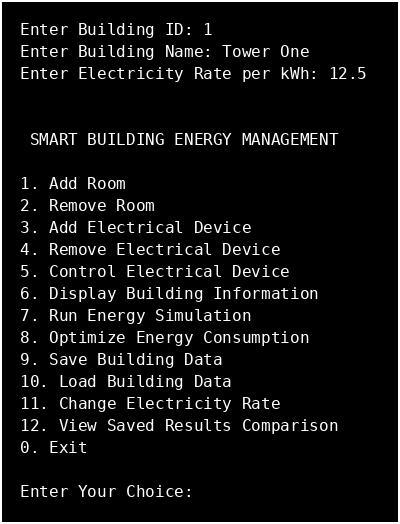

### 2. Adding Rooms
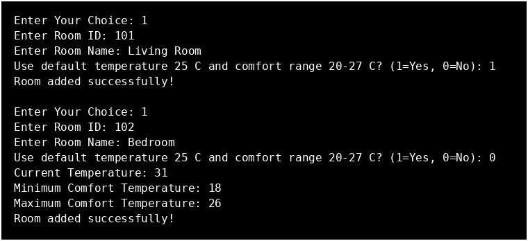

### 3. Adding Electrical Devices
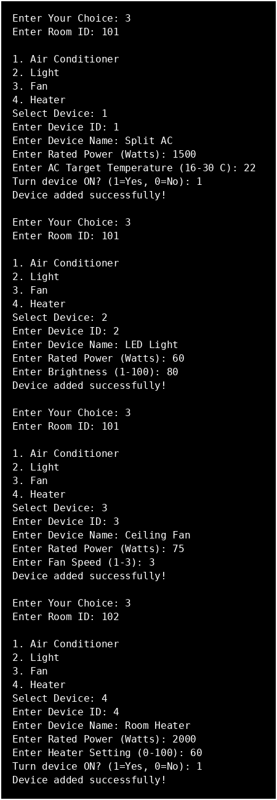

### 4. Building Information
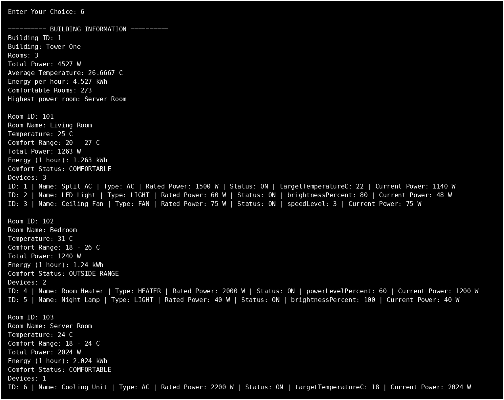

### 5. Device Control
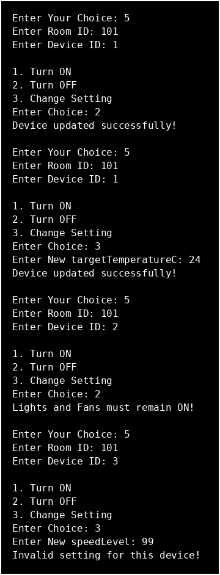

### 6. Energy Simulation
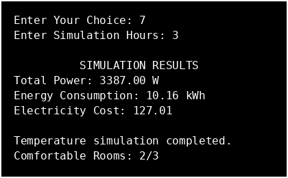

### 7. Energy Optimization
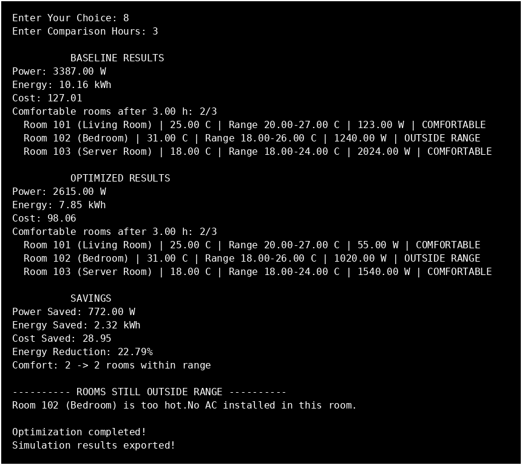

### 8. Save, Load and Results Comparison
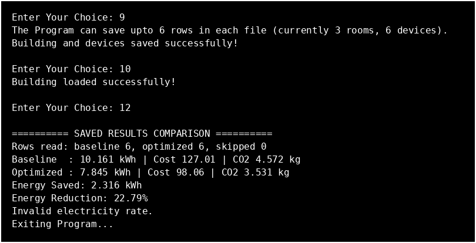

### 9. Startup Input Validation
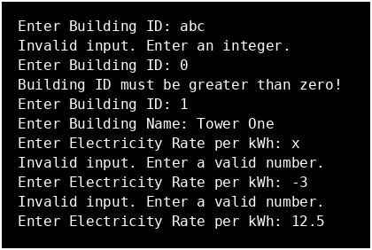

### 10. Error Handling
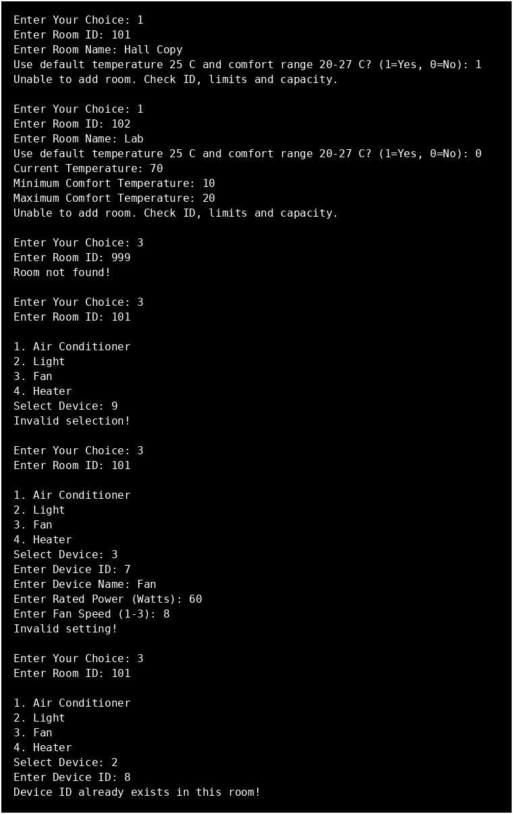

### 11. Additional Error Handling
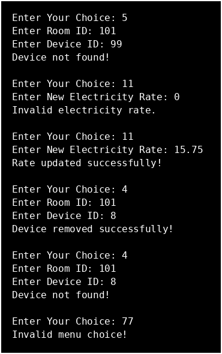
